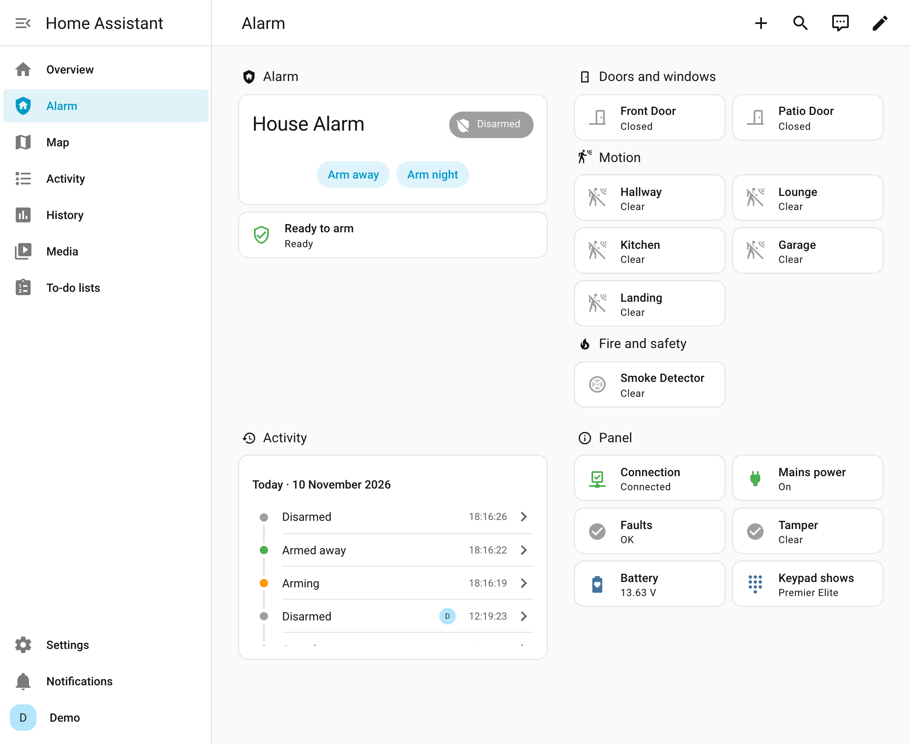

# Texecom Premier Elite for Home Assistant

Use your Texecom **Premier Elite** alarm from **Home Assistant** (and Apple Home), through the **SmartCom** you already have. Install it from HACS (or the Marketplace, from Home Assistant 2026.11), type your SmartCom's address, and Home Assistant reads your zones from the panel. No add-on, no MQTT, no files to edit. [Take the quick tour →](https://metaljay.github.io/ha-texecom/)

> **Unofficial.** Not made or supported by Texecom. Tested on Premier Elite 12, 24, 64 and 168 panels ([which ones](https://github.com/metaljay/ha-texecom#tested-panels)). **Tried it on another panel? [Tell us how it went](https://github.com/metaljay/ha-texecom/issues/new?template=1-tested.yml)**, even if it all worked.

<h2 id="what-you-get">✨ What you get</h2>

- 🛡️ **An alarm** you can set to **Away**, **Night** or **Home**, or turn off, and see when it's arming, waiting for you to come in, or going off, and whether it's **ready to arm**. Changes at the keypad show straight away.
- 🚪 **A sensor for every zone**, named as on your panel: doors, windows, motion, smoke and gas.
- 📋 **A ready-made Alarm dashboard**, built for you at the end of setup.
- 🔋 **Panel health**: connection, mains power, battery, tampers, and what the keypad says.
- 👤 **Who did it**: *changed by Sam* rather than *User 3*, with the names stored in the panel filled in for you (change them if you like), and an activity list in plain words: *didn't arm: Kitchen was active*, *reported a tamper*…
- 🔔 **Notifications** in Home Assistant when the alarm couldn't arm, the panel is on battery, or a tamper opens, saying what to check.
- ⚡ **One-click automations**: arm when everyone leaves (or ask you first), and tell your phone when the alarm goes off. [Add them →](https://github.com/metaljay/ha-texecom/blob/main/docs/user/automations.md)
- 🍏 **Apple Home** too, through Home Assistant's built-in HomeKit Bridge.

<h2 id="what-you-need">🧰 What you need</h2>

- A Texecom **Premier Elite** panel with a **SmartCom** (the box the Texecom app uses) or a **ComIP**.
- The panel's **UDL code** (its remote-access code). Texecom's default is **1234**, and most panels keep it.
- **Home Assistant** 2025.7 or newer, with [HACS](https://hacs.xyz) (from 2026.11 it's built in, as the *Marketplace*).

> ℹ️ The SmartCom talks to one thing at a time: while Home Assistant is connected, the Texecom app can't. Your alarm (and the app's alarm notifications) carry on as normal. Turn off Homebridge or texecom2mqtt first if you use them.

<h2 id="install-and-set-up">🚀 Install and set up, in four steps</h2>

1. **Find your SmartCom's address** in your router's list of devices (something like `192.168.1.50`), and reserve it so it never changes.
2. **Install**: click the button at the top of this page, then **Download** and restart Home Assistant (HACS), or **Install** (the Marketplace, Home Assistant 2026.11 and newer).
3. **Add the integration**: click below, choose **Texecom Connect**, and enter the address and UDL code (leave the port at 10001).

   
4. **Choose your arm modes**: which *part arm* **Night** and **Home** use (or *Not used*), keep **Add an Alarm dashboard** ticked, and click **Submit**, then **Finish**. Done 🎉

**[Step-by-step guide with pictures →](https://github.com/metaljay/ha-texecom/blob/main/docs/user/setup.md)**

<h2 id="using-it">📚 Using it, and more help</h2>

| I want to… | Read |
|---|---|
| Set it up step by step, or understand part arms | [Setting it up](https://github.com/metaljay/ha-texecom/blob/main/docs/user/setup.md) |
| Know what the states, sensors and options mean | [Using it](https://github.com/metaljay/ha-texecom/blob/main/docs/user/using.md) |
| Give keypad users names, or change the options | [Options](https://github.com/metaljay/ha-texecom/blob/main/docs/user/using.md#options) |
| Use it in the Home app on iPhone | [Apple Home](https://github.com/metaljay/ha-texecom/blob/main/docs/user/apple-home.md) |
| Arm automatically when everyone leaves, or get told when it goes off | [Automations](https://github.com/metaljay/ha-texecom/blob/main/docs/user/automations.md) |
| Fix a problem | [Troubleshooting](https://github.com/metaljay/ha-texecom/blob/main/docs/user/troubleshooting.md) |
| Build the Alarm dashboard by hand (if Home Assistant couldn't) | [Build the dashboard yourself](https://github.com/metaljay/ha-texecom/blob/main/docs/user/using.md#build-the-dashboard-yourself) |
| Use a COM port set to Crestron instead of a SmartCom | [Crestron](https://github.com/metaljay/ha-texecom/blob/main/docs/user/crestron.md) |
| Move over from Homebridge or texecom2mqtt | [Coming from Homebridge](https://github.com/metaljay/ha-texecom/blob/main/docs/user/setup.md#coming-from-homebridge-or-texecom2mqtt) |

<h2 id="tested-panels">✅ Tested panels</h2>

These panels have run it. Each row links to what was reported.

| Panel | Firmware | Connection | What was tried |
|---|---|---|---|
| Elite&nbsp;12 | V6.03.02 | ComIP | Two areas: setup found the zones and both areas, zones show activity, one area armed on its own, each area shows its own *Ready to arm*, a smoke detector ([#4](https://github.com/metaljay/ha-texecom/issues/4)) |
| Elite&nbsp;24 | V5.02.01 | ComIP (Texecom Connect) | Two areas: setup found the zones and both areas, and arming Night and Away at the keypad showed in Home Assistant ([discussion #38](https://github.com/metaljay/ha-texecom/discussions/38)) |
| Elite&nbsp;24 | V6.05.03 | SmartCom; Crestron through an ESP Easy serial server | The maintainer's own panel. Over the SmartCom, all of it: arming, part arms, alarms, tampers, mains failure, keypad changes. Over Crestron, zones, arming and disarming |
| Elite&nbsp;24 | V6.06.03 | SmartCom (managed by Texecom Cloud) | Setup, zones, arming Away and the part arms from Home Assistant, the Alarm dashboard ([#30](https://github.com/metaljay/ha-texecom/issues/30)) |
| Elite&nbsp;24 | V6.06.03 | ComWiFi | Setup found the zones and the area, and the panel's power readings came through ([discussion #1](https://github.com/metaljay/ha-texecom/discussions/1)) |
| Elite&nbsp;64 | V5.00.03 | Texecom Connect, through a home-made ESP32 serial bridge | Three areas: setup, zones, arming Away and a part arm, disarming, arms at the keypad, an alarm going off naming the zone, keypad user names ([#36](https://github.com/metaljay/ha-texecom/issues/36)) |
| Elite&nbsp;64 | not given | ComIP (Texecom Connect) | A part arm shown as Vacation, set from Home Assistant and at the keypad, with automations firing on it ([#32](https://github.com/metaljay/ha-texecom/issues/32)) |
| Elite&nbsp;168 | V6.06.03 | Crestron, through a USR-TCP232 adapter | Part arm and disarm (the panel refuses Crestron's own arm commands, so Texecom Connect's are used inside the session), power readings, the stored event log, a failed arm ([PR #46](https://github.com/metaljay/ha-texecom/pull/46)) |

**Testers wanted** for the Elite 48, 88 and 640, for Texecom Connect on an Elite 168, for Crestron on any panel except the Elite 24 and 168, and for wireless (Ricochet) detectors, which the maintainer's panel doesn't have. More reports on the models above help too. **[Tell us how it went](https://github.com/metaljay/ha-texecom/issues/new?template=1-tested.yml)**, even if you only got as far as setup. Attach the **Download diagnostics** file from the panel's device page: codes and addresses are removed automatically.

<h2 id="help-and-feedback">💬 Help and feedback</h2>

**Have a panel, module or detector that isn't covered yet?** [Share your panel's data](https://github.com/metaljay/ha-texecom/issues/new?template=3-data.yml): a download and a few notes are how new features get added. [More on helping](https://github.com/metaljay/ha-texecom/blob/main/CONTRIBUTING.md).

**Something wrong?** [Report a bug](https://github.com/metaljay/ha-texecom/issues/new?template=2-bug.yml) · **Questions?** [Discussions](https://github.com/metaljay/ha-texecom/discussions)

<h2 id="working-on-the-code">🧑‍💻 Working on the code</h2>

The code is split into small compartments, each with one job and its own tests, so a fix or feature touches one place. Start with the [developer guide](https://github.com/metaljay/ha-texecom/blob/main/docs/development/README.md); AI coding agents should read [AGENTS.md](https://github.com/metaljay/ha-texecom/blob/main/AGENTS.md) first.

<h2 id="credits">🙏 Credits</h2>

The Texecom Connect protocol support follows the publicly released [texecom-connect](https://github.com/davidMbrooke/texecom-connect) by Joseph Heenan (Apache-2.0), and arming and the zone/area reads are adapted from [texecom2mqtt](https://github.com/dchesterton/texecom2mqtt-hassio) by Daniel Chesterton (MIT). The Crestron support grew out of the Homebridge plugin by Kieran Jones, max-christian and [Chris Posthumus](https://github.com/K1LL3R234/homebridge-texecom) (MIT); the protocol work is shared with the [Homebridge plugin fork](https://github.com/metaljay/homebridge-texecom). Full details are in [NOTICE](https://github.com/metaljay/ha-texecom/blob/main/NOTICE).

<h2 id="legal">⚖️ Legal</h2>

- **Not affiliated with Texecom.** Texecom, Premier Elite, SmartCom, ComIP and Wintex are trademarks of Texecom Ltd, used here only to say which products this works with. This is an independent, unofficial project, not made, endorsed or supported by Texecom.
- **No Texecom material.** The repository contains no Texecom documentation, firmware, software or logos. The protocol support is built on the open-source projects credited in [NOTICE](https://github.com/metaljay/ha-texecom/blob/main/NOTICE), used under their licences, and on testing with the owner's own panel.
- **No warranty; use at your own risk.** This software is provided as is (see [LICENSE](https://github.com/metaljay/ha-texecom/blob/main/LICENSE)). It isn't a certified security product or a replacement for your alarm's own keypads, monitoring or app. Don't rely on Home Assistant alone to know whether your alarm is set or going off.
- **Rights holders.** If you are Texecom, or hold rights in anything here, and want something changed or removed, please [open an issue](https://github.com/metaljay/ha-texecom/issues/new) or use GitHub's own [content removal process](https://docs.github.com/en/site-policy/content-removal-policies). Requests will be dealt with promptly and in good faith, including taking the project down if asked.

